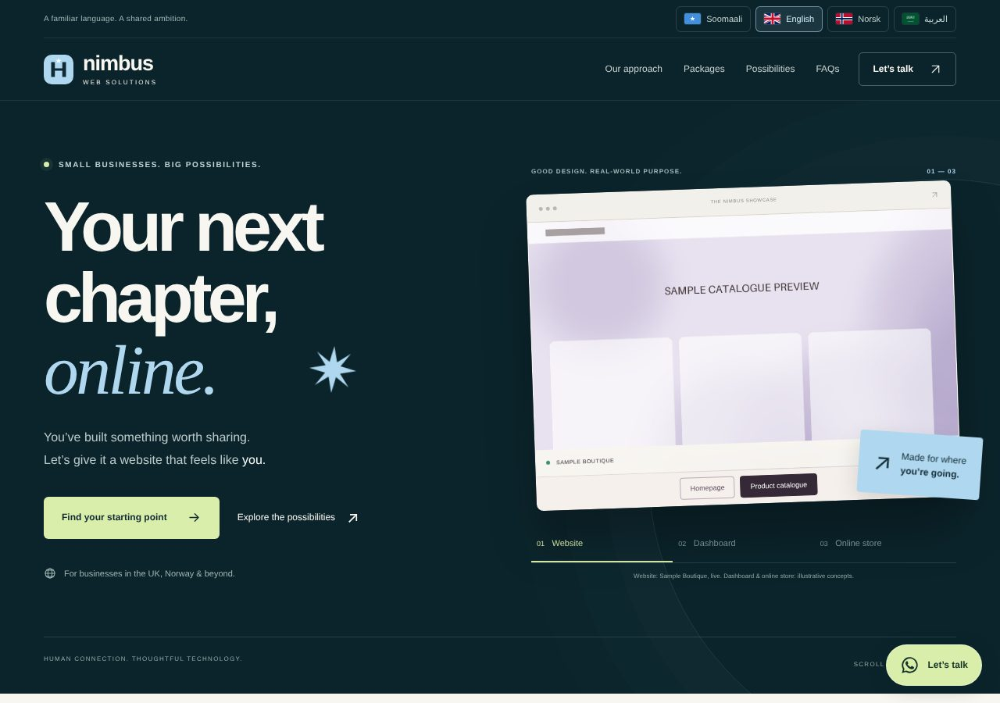
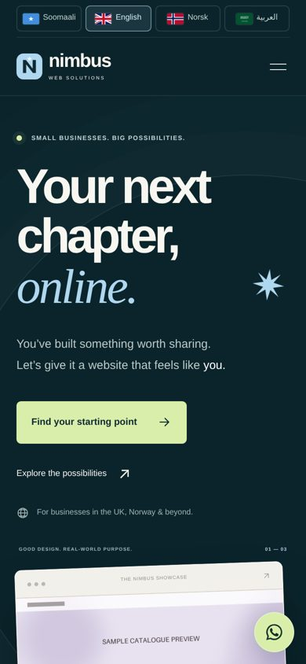

# Multilingual Agency Website Template

A responsive, single-page marketing site for a small web studio, available in **English, Somali, Arabic (RTL) and Norwegian**. Built with plain HTML, CSS and vanilla JavaScript — no framework and no build step.

> All names, contact details and images are fictional placeholders.



<p align="center"></p>

## 🚀 Key Features

- **4 languages with live switching:** Translation strings live in `i18n.js` and the choice is remembered in `localStorage`. Arabic switches the whole layout to right-to-left.
- **Interactive concept previews:** A product-dashboard demo and an e-commerce checkout demo (illustrations only — no real backend or payments).
- **WhatsApp enquiry form:** Builds a pre-filled message in the browser; nothing is sent to a server.
- **Packages & pricing section** that stays readable down to small phones.
- **Local SVG flags** instead of emoji flags (avoids the Windows emoji-flag rendering bug).
- **Accessibility:** semantic landmarks, labelled controls, `aria-live` status messages and keyboard-friendly dialogs.

## 💻 Technology Stack

- **Languages:** HTML5, CSS3, JavaScript (ES6+)
- **Internationalisation:** custom `i18n.js` with RTL support
- **Hosting:** any static host (built for Cloudflare Pages, includes a `_headers` file)
- **Tools:** Git, no bundler

## 📁 Project Structure

```
index.html   page markup
styles.css   styles
app.js       interactions (form, demos, language bar)
i18n.js      translation strings (EN | SO | AR | NO)
assets/      SVG flags/mark and placeholder images
_headers     security headers for Cloudflare Pages
```

## 🛠️ Run Locally

```bash
python3 -m http.server 8000
# open http://localhost:8000
```

## ✏️ Customise

1. Set your WhatsApp number in `app.js` (`WA_PHONE`) and in the links in `index.html`.
2. Replace the example email addresses in `index.html`.
3. Edit copy in `index.html` and the matching entries in `i18n.js` (the English text is the lookup key).
4. Swap the placeholder images in `assets/`.

This project shows how I approach a small, fast and accessible multilingual site without any dependencies.

## 📄 License

MIT — see [LICENSE](LICENSE).
